# Evidencias de Sistema — Sprint 5
**Proyecto:** Perfil Médico+ (APT122)  
**Fecha de ejecución:** 13 de noviembre de 2026  
**Entorno de pruebas:** Docker Compose (`backend-api-1` FastAPI + `backend-db-1` PostgreSQL) + Emulador Android (Flutter)  
**Usuario titular/cuidador:** Martin Seamus McFly (`bcc7d41b-fdd8-4827-865f-c92bae51b8ae`)
**Perfil de prueba principal:** Dr. Emmett Brown (`1127a031-1d1a-4f8a-9408-2ddb9fe44288`)  


---

## 1. Preparación del Entorno y Migraciones (`S5_00`)

Antes de ejecutar las pruebas funcionales del Sprint 5, se verificó el estado de los contenedores en Docker y la sincronización del esquema de base de datos en PostgreSQL mediante Alembic, asegurando la creación de las tablas para eventos de seguridad, pulseras GPS y geocercas (`e2f3a4b5c6d7_crear_tablas_pulsera.py`).

| Código | Archivo de Evidencia | Descripción Técnica |
| :--- | :--- | :--- |
| **`S5_00.4`** | `S5_00.4_alembic_check.png` | Ejecución de `docker compose exec api alembic check` confirmando `No new upgrade operations detected.` |

### Vista previa de evidencias (`S5_00`)
* **`S5_00.4_alembic_check.png`**  
  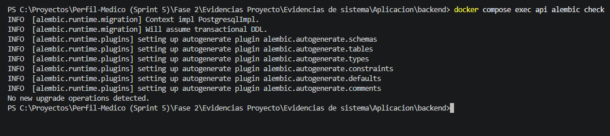

---

## 2. HU 13 — Porcentaje de Cumplimiento de Rutinas y Medicamentos (`S5_02`)

**Objetivo:** Permitir al cuidador visualizar el porcentaje de adherencia/cumplimiento del adulto mayor en ventanas móviles de **7, 14 y 30 días**, desglosado tanto **por día** como **por categoría** (*Medicamentos, Hidratación, Alimentación y Otras rutinas*), excluyendo del cálculo aquellas actividades programadas para hoy cuya hora aún no ha llegado.

### Resumen de evidencias (`S5_02`)

| Código | Archivo de Evidencia | Descripción Técnica |
| :--- | :--- | :--- |
| **`S5_02.1a`** | `S5_02.1a_agenda_confirmadas.png` | Vista «Agenda de hoy» (13/11/2026) mostrando 3 de 13 actividades confirmadas (*Tomar vasos de agua*, *Desayuno* y *Losartán*). |
| **`S5_02.1b (7d)`** | `S5_02.1b_cumplimiento_7_dias.png` | Pantalla «Cumplimiento · Dr. Emmett Brown» filtrada a **7 días**: 9 % global (3 de 33 actividades cumplidas), gráfico diario y barras por categoría. |
| **`S5_02.1b (14d)`**| `S5_02.1b_cumplimiento_14_dias.png`| Pantalla «Cumplimiento · Dr. Emmett Brown» filtrada a **14 días**: 9 % global (3 de 33 actividades cumplidas). |
| **`S5_02.1b (30d)`**| `S5_02.1b_cumplimiento_30_dias.png`| Pantalla «Cumplimiento · Dr. Emmett Brown» filtrada a **30 días**: 14 % global (13 de 94 actividades cumplidas), incluyendo histórico de octubre. |
| **`S5_02.1c1`** | `S5_02_1c1_swagger_7_dias_totales_y_categorias.png` | Petición `GET /perfiles/{perfil_id}/cumplimiento?desde=2026-11-07&hasta=2026-11-13` (`Code 200`) mostrando totales y desglose `"por_categoria"`. |
| **`S5_02.1c2`** | `S5_02_1c2_swagger_7_dias_por_dia.png` | Continuación del JSON de respuesta en Swagger mostrando el arreglo `"por_dia"` con las métricas diarias. |
| **`S5_02.1d`** | `S5_02_1d_swagger_cumplimiento_hoy.png` | Petición `GET /perfiles/{perfil_id}/cumplimiento?desde=2026-11-13&hasta=2026-11-13` (`Code 200`) validando el cálculo exclusivo del día actual. |
| **`S5_02.2a`** | `S5_02_2a_agenda_hoy_pendientes_futuras.png` | Vista de la agenda a las 15:56 hrs evidenciando actividades pendientes con horarios futuros (20:15 y 20:30 hrs). |
| **`S5_02.2b`** | `S5_02_2b_swagger_hoy_excluye_futuras.png` | Validación en Swagger (`desde=2026-11-13&hasta=2026-11-13`) comprobando que `"total": 10` excluye las actividades futuras que aún no vencen. |

### Galería de evidencias (`S5_02`)
* **`S5_02.1a_agenda_confirmadas.png`**  
  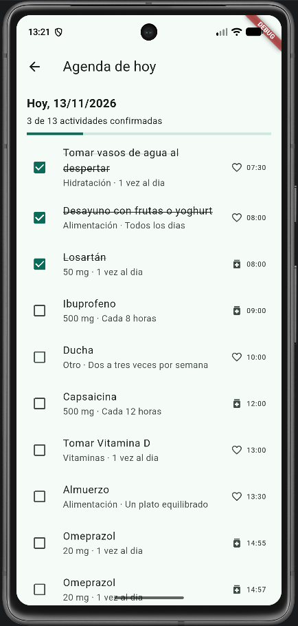
* **`S5_02.1b_cumplimiento_7_dias.png`**  
  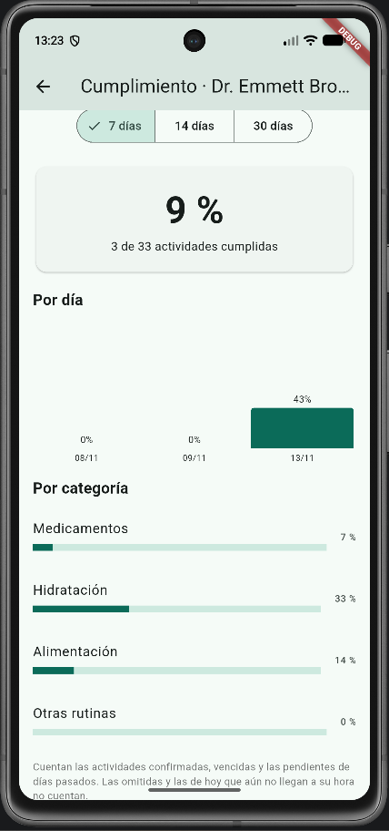
* **`S5_02.1b_cumplimiento_14_dias.png`**  
  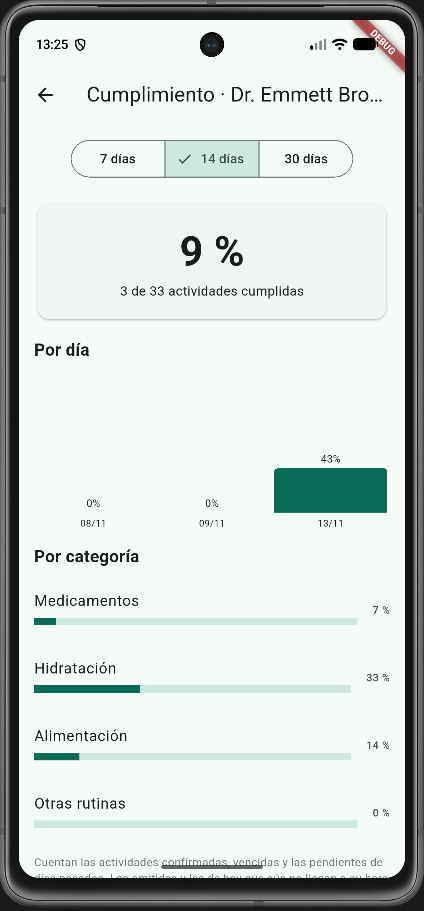
* **`S5_02.1b_cumplimiento_30_dias.png`**  
  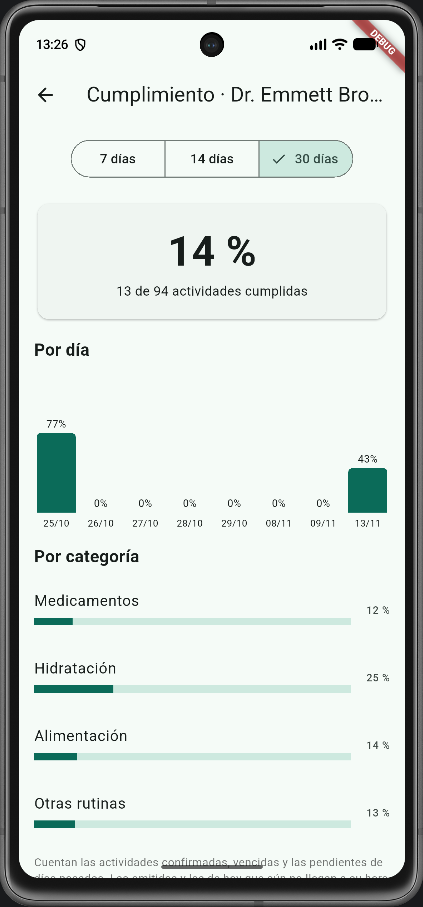
* **`S5_02_1c1_swagger_7_dias_totales_y_categorias.png`**  
  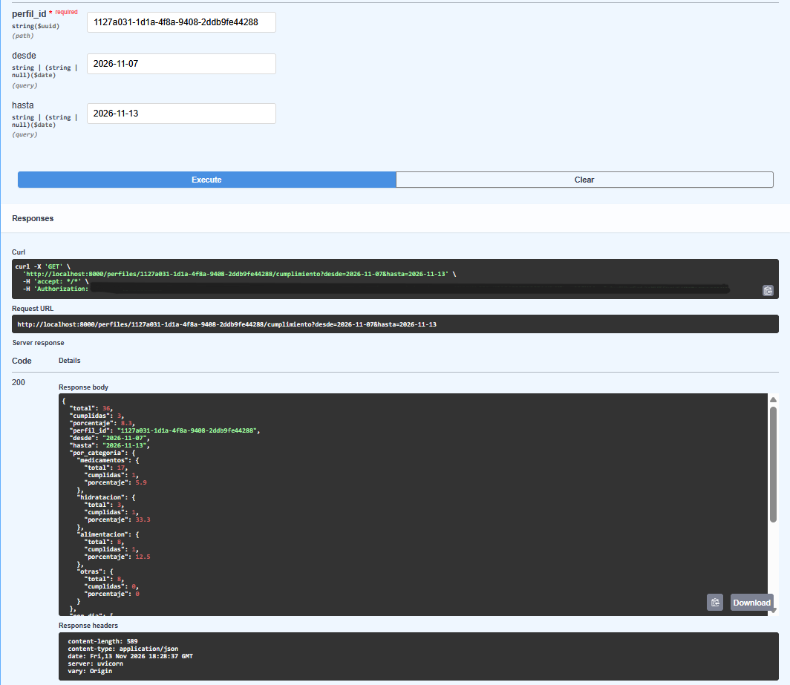
* **`S5_02_1c2_swagger_7_dias_por_dia.png`**  
  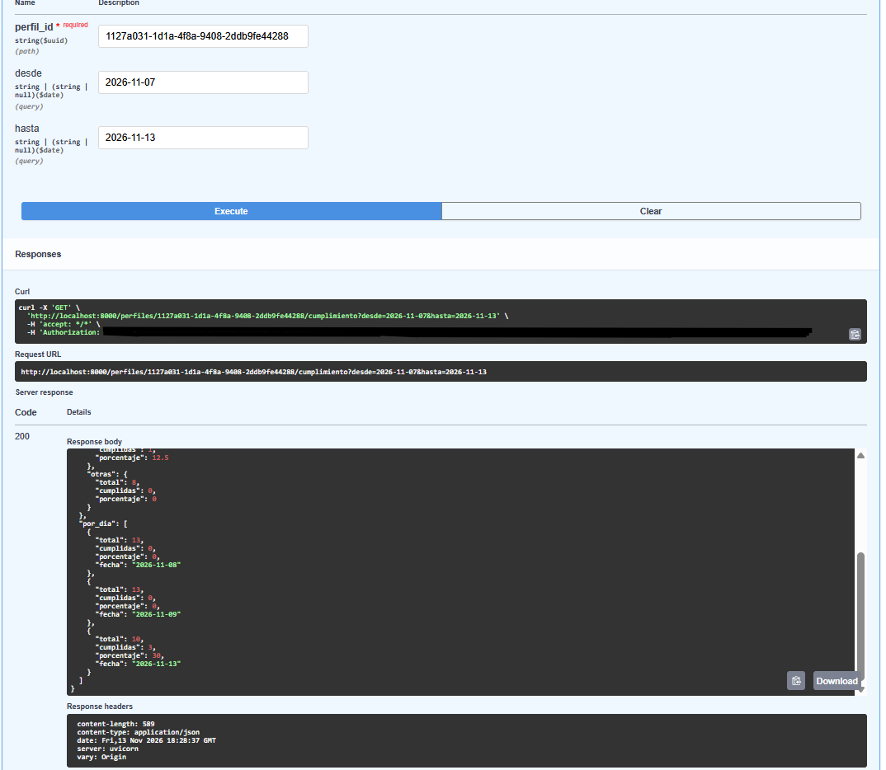
* **`S5_02_1d_swagger_cumplimiento_hoy.png`**  
  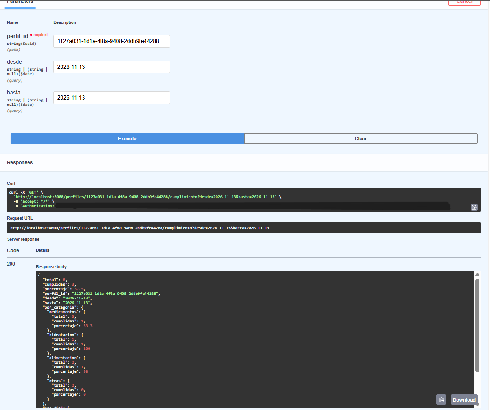
* **`S5_02_2a_agenda_hoy_pendientes_futuras.png`**  
  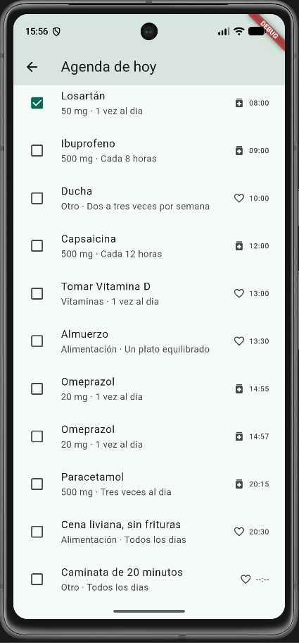
* **`S5_02_2b_swagger_hoy_excluye_futuras.png`**  
  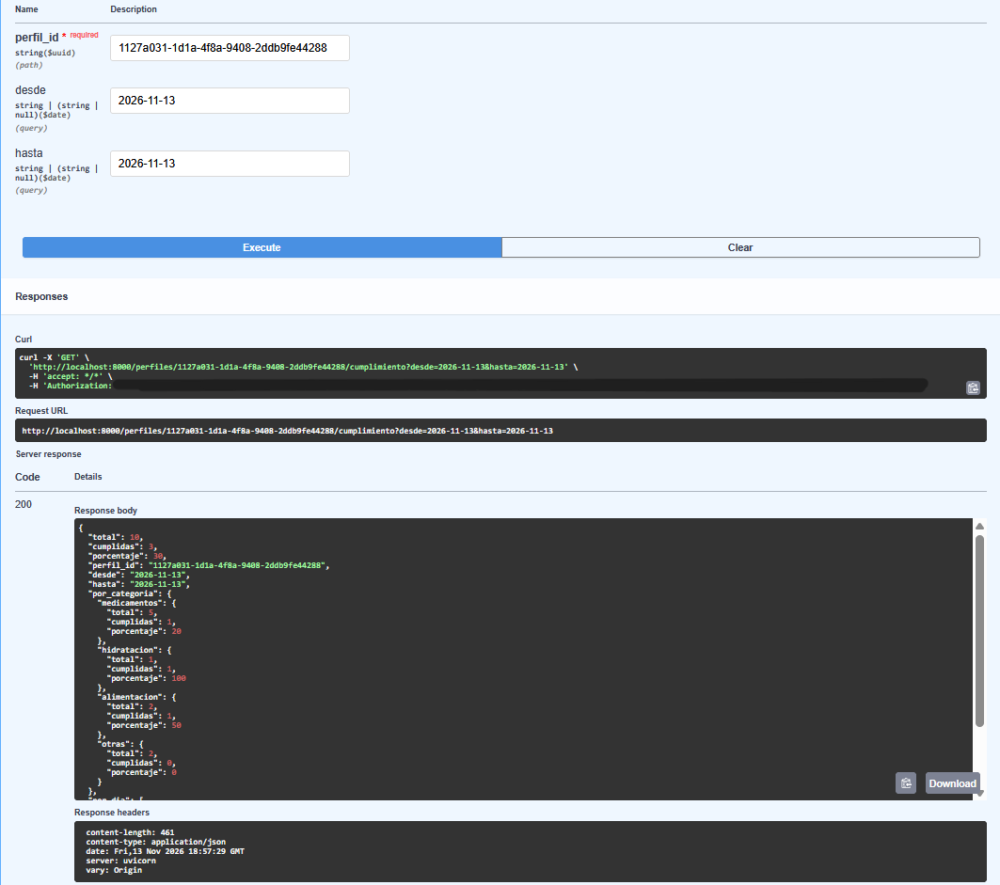

---

## 3. HU 14 y HU 15 — Botón «Necesito ayuda» y Bandeja de Eventos de Seguridad (`S5_03`)

**Objetivo:**  
* **HU 14:** Incorporar en la interfaz de «Modo simplificado» del adulto mayor un botón prominente de emergencia (**«SOS Necesito ayuda»**) con diálogo de confirmación para evitar pulsaciones accidentales y notificación inmediata a los cuidadores.  
* **HU 15:** Proveer al cuidador una bandeja centralizada de **«Eventos de seguridad»** donde pueda revisar las alertas pendientes y marcarlas como **«Atendido»**, registrando la trazabilidad en la base de datos (`atendido_en` y `atendido_por_id`).

### Resumen de evidencias (`S5_03`)

| Código | Archivo de Evidencia | Descripción Técnica |
| :--- | :--- | :--- |
| **`S5_03.1a`** | `S5_03.1a_modo_simplificado_boton_ayuda.png` | Vista «Modo simplificado» del perfil *Dr. Emmett Brown* destacando el botón rojo **«SOS Necesito ayuda»**. |
| **`S5_03.1b`** | `S5_03.1b_modal_confirmar_pedir_ayuda.png` | Diálogo modal de confirmación preventiva: *«¿Pedir ayuda? Se avisará a tus cuidadores ahora mismo.»* |
| **`S5_03.1c`** | `S5_03.1c_snackbar_aviso_enviado.png` | Retroalimentación visual (`SnackBar`): *«Listo, avisamos a tus cuidadores.»* tras confirmar el envío. |
| **`S5_03.1d`** | `S5_03.1d_eventos_seguridad_alerta_recibida.png` | Vista «Eventos de seguridad» en la sesión del cuidador mostrando el evento activo (`Pidió ayuda · Dr. Emmett Brown`) y la acción **«Atender»**. |
| **`S5_03.1e`** | `S5_03.1e_eventos_seguridad_alerta_atendida.png` | Evento actualizado al estado **«Atendido»** con ícono de verificación verde (`✓`). |
| **`S5_03.1f`** | `S5_03.1f_swagger_post_asistencia.png` | Ejecución de `POST /perfiles/{perfil_id}/asistencia` en Swagger devolviendo `Code 201` con `"tipo": "asistencia"` y `"origen": "app"`. |
| **`S5_03.1g`** | `S5_03.1g_swagger_get_eventos_pendientes.png` | Consulta `GET /eventos?solo_pendientes=true&limite=50` (`Code 200`) listando el evento pendiente con `"atendido_en": null`. |
| **`S5_03.1h`** | `S5_03.1h_swagger_get_eventos_atendidos.png` | Consulta `GET /eventos?solo_pendientes=false&limite=50` (`Code 200`) evidenciando la persistencia de `"atendido_en"` y `"atendido_por_id"`. |

### Galería de evidencias (`S5_03`)
* **`S5_03.1a_modo_simplificado_boton_ayuda.png`**  
  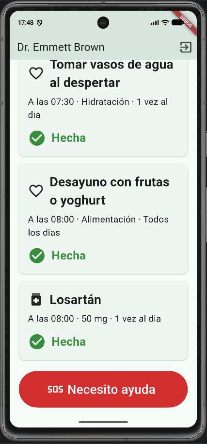
* **`S5_03.1b_modal_confirmar_pedir_ayuda.png`**  
  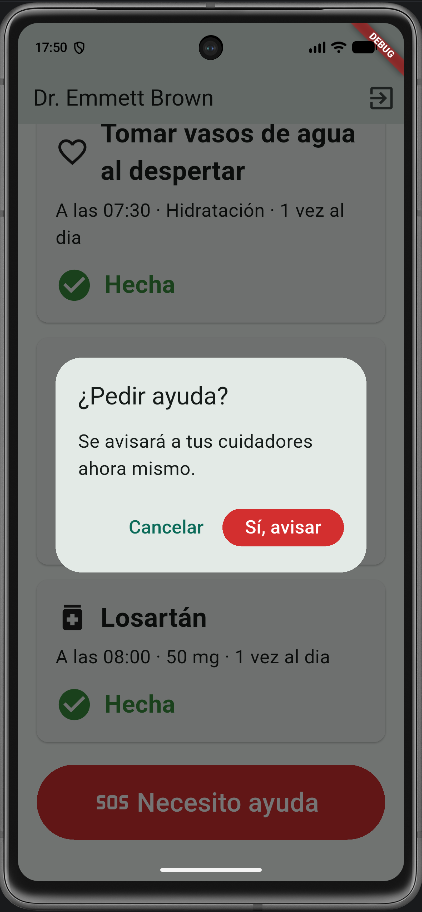
* **`S5_03.1c_snackbar_aviso_enviado.png`**  
  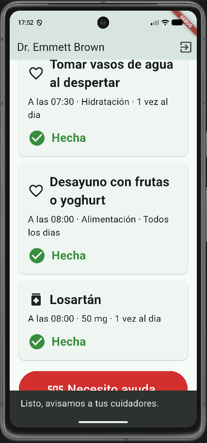
* **`S5_03.1d_eventos_seguridad_alerta_recibida.png`**  
  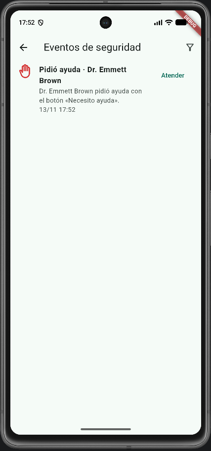
* **`S5_03.1e_eventos_seguridad_alerta_atendida.png`**  
  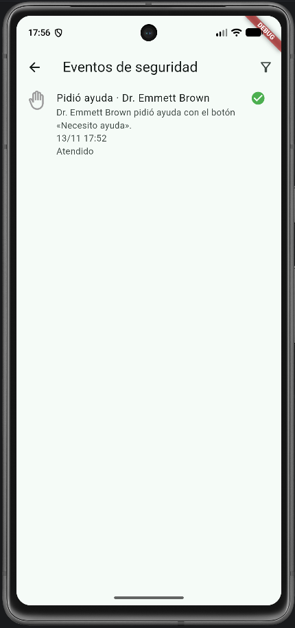
* **`S5_03.1f_swagger_post_asistencia.png`**  
  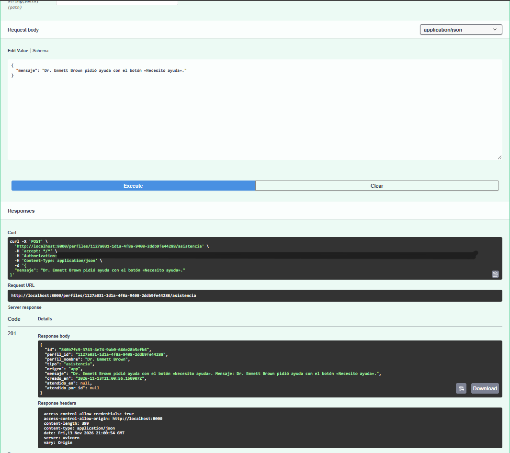
* **`S5_03.1g_swagger_get_eventos_pendientes.png`**  
  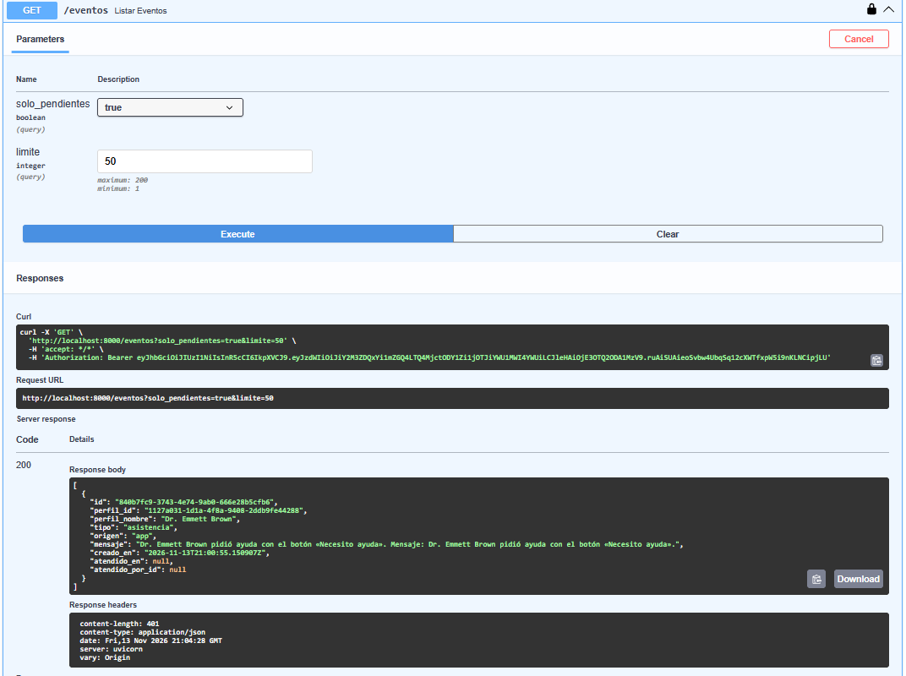
* **`S5_03.1h_swagger_get_eventos_atendidos.png`**  
  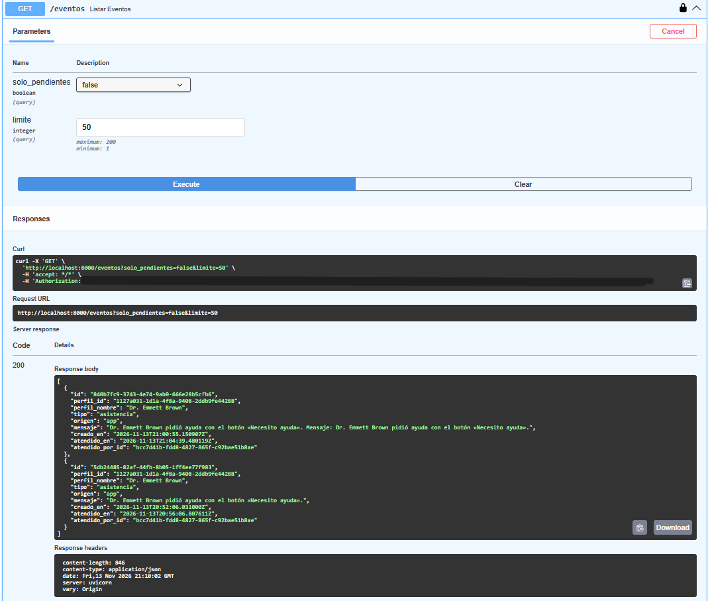

---

## 4. HU 17 — Vinculación de Pulsera GPS, Ubicación y Geocercas (`S5_04`)

**Objetivo:** Permitir el registro de una pulsera GPS asociada al perfil del adulto mayor, la definición de zonas seguras (geocercas con coordenada central y radio en metros) y la visualización en la aplicación móvil del nivel de batería, hora de última conexión y última ubicación reportada.

### Parámetros configurados en la prueba
* **Variable de entorno habilitada:** `TRACCAR_TOKEN=clave-secreta-sprint5` en `.env`.
* **Pulsera vinculada:** `Pulsera Dr. Brown` | Identificador: `PULSERA-EMMETT-01` | Modelo: `Liliput GPS SOS` | ID BD: `9e755d13-2862-4759-9353-34d43992e075`.
* **Geocerca registrada:** `Casa Dr. Brown` | Coordenadas: `-33.4489, -70.6693` | Radio: `200 m` | ID BD: `25c34130-1b41-45d6-ac0d-03b12bd862ef`.

### Resumen de evidencias (`S5_04`)

| Código | Archivo de Evidencia | Descripción Técnica |
| :--- | :--- | :--- |
| **`S5_04.1a`** | `S5_04.1a_swagger_post_registrar_pulsera.png` | Petición `POST /perfiles/{perfil_id}/pulseras` en Swagger registrando el dispositivo `PULSERA-EMMETT-01` (`Code 201`). |
| **`S5_04.1b`** | `S5_04.1b_swagger_post_crear_geocerca.png` | Petición `POST /perfiles/{perfil_id}/geocercas` en Swagger creando la zona segura `Casa Dr. Brown` con `radio_m: 200` (`Code 201`). |
| **`S5_04.1c`** | `S5_04.1c_app_pulsera_y_geocercas.png` | Pantalla «Pulsera · Dr. Emmett Brown» en la app móvil mostrando la pulsera vinculada, nivel de batería (`9 %`), última conexión (`13/11 20:55`), coordenadas (`-33.43992, -70.66930`) y la geocerca activa (`Casa Dr. Brown · Radio 200 m`). |

### Galería de evidencias (`S5_04`)
* **`S5_04.1a_swagger_post_registrar_pulsera.png`**  
  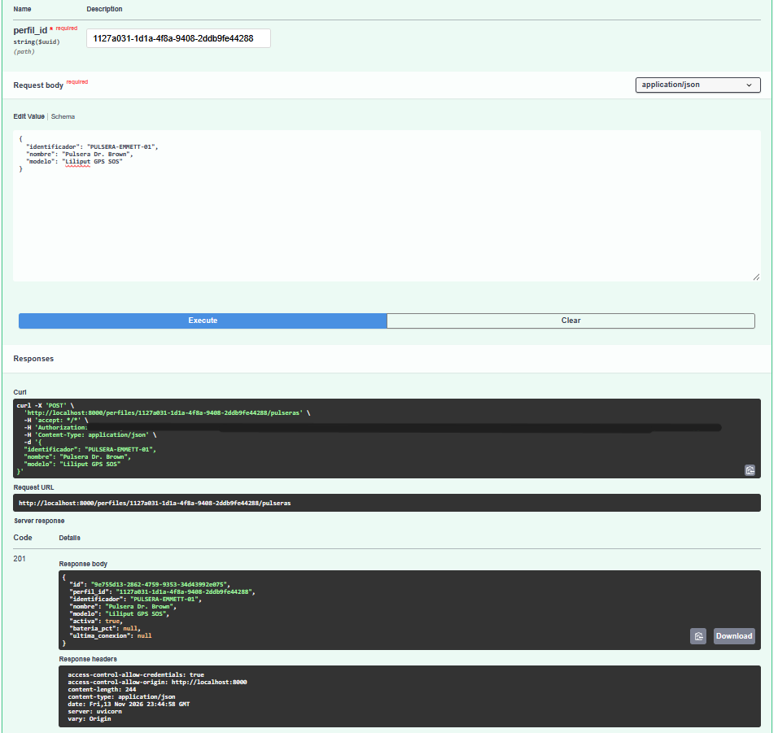
* **`S5_04.1b_swagger_post_crear_geocerca.png`**  
  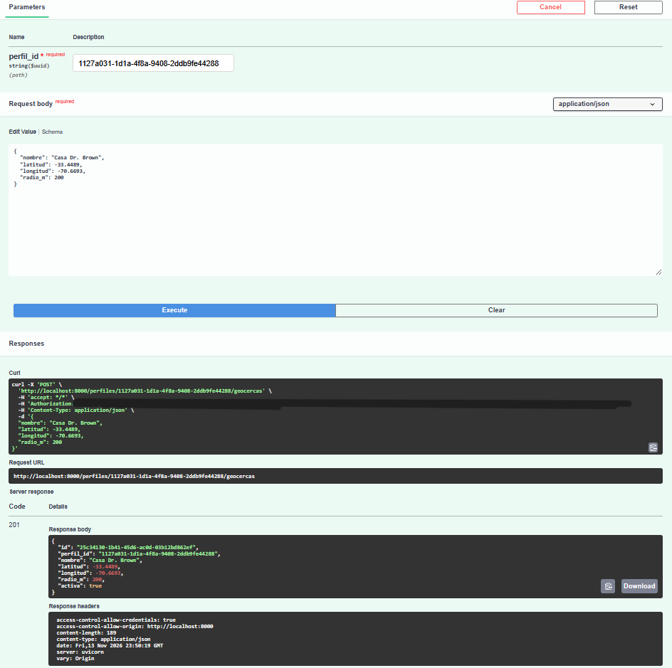
* **`S5_04.1c_app_pulsera_y_geocercas.png`**  
  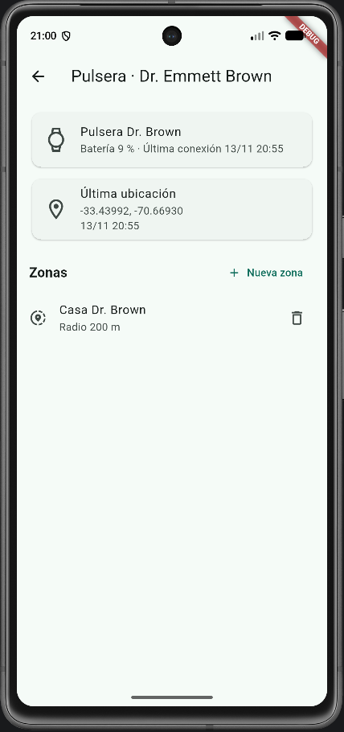

---

## 5. HU 19 — Recepción de Eventos de Seguridad desde Pulsera GPS (`S5_05`)

**Objetivo:** Procesar las lecturas entrantes desde la pulsera GPS en el endpoint `/traccar/posiciones` y generar automáticamente alertas de seguridad para los cuidadores ante cuatro escenarios críticos: **pulsación del botón SOS**, **detección de posible caída (`fallDown`)**, **batería baja ($\le 15\%$)** y **salida de una zona segura (geocerca)**.

### Comandos ejecutados en el simulador (`scripts/simular_pulsera.py`)
```powershell
python scripts/simular_pulsera.py --token clave-secreta-sprint5 --id PULSERA-EMMETT-01 sos
python scripts/simular_pulsera.py --token clave-secreta-sprint5 --id PULSERA-EMMETT-01 caida
python scripts/simular_pulsera.py --token clave-secreta-sprint5 --id PULSERA-EMMETT-01 bateria --porcentaje 9
python scripts/simular_pulsera.py --token clave-secreta-sprint5 --id PULSERA-EMMETT-01 recorrido --lat -33.4489 --lon -70.6693 --metros 1000
```

### Resumen de evidencias (`S5_05`)

| Código | Archivo de Evidencia | Descripción Técnica |
| :--- | :--- | :--- |
| **`S5_05.1a`** | `S5_05.1a_consola_simulador_alarmas.png` | Ejecución del script `scripts/simular_pulsera.py` en consola enviando los paquetes de SOS, caída, batería al 9 % y recorrido de 1000 m hacia el norte fuera de la geocerca. |
| **`S5_05.1b`** | `S5_05.1b_app_eventos_pulsera.png` | Pantalla «Eventos de seguridad» en la app móvil mostrando las 4 alertas generadas por la pulsera: *Salió de una zona («Casa Dr. Brown»)*, *Batería baja (9 %)*, *Posible caída* y *Botón SOS*. |
| **`S5_05.1c`** | `S5_05.1c_swagger_get_eventos_pulsera.png` | Consulta `GET /eventos?solo_pendientes=true&limite=50` (`Code 200`) en Swagger verificando los registros creados con `"origen": "pulsera"` y tipos `"bateria_baja"`, `"caida"`, `"sos"` y `"salida_geocerca"`. |

### Galería de evidencias (`S5_05`)
* **`S5_05.1a_consola_simulador_alarmas.png`**  
  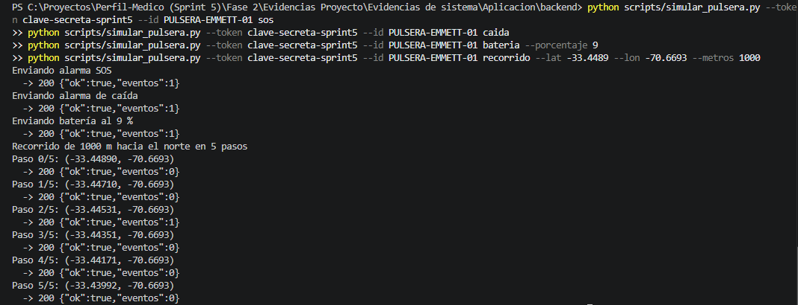
* **`S5_05.1b_app_eventos_pulsera.png`**  
  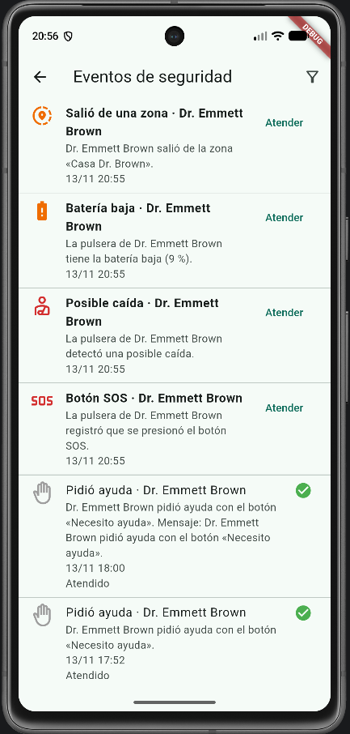
* **`S5_05.1c_swagger_get_eventos_pulsera.png`**  
  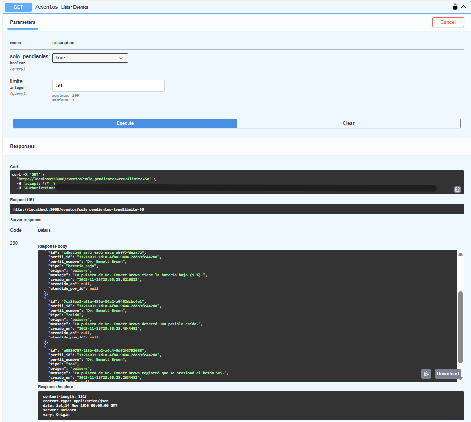