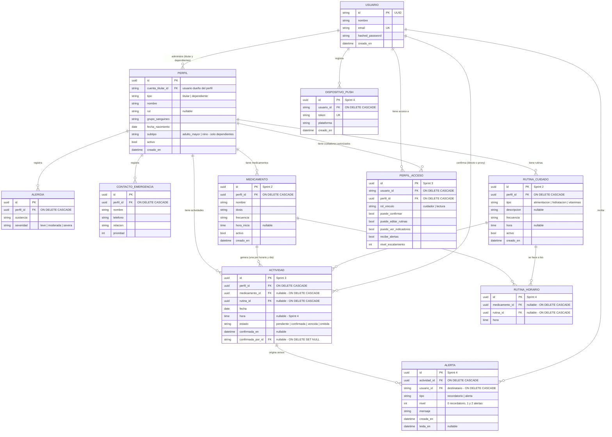

# Modelo de Datos — Perfil Médico+

**Responsable:** Sergio Ocares · **Sprint 1** (S5-S6), actualizado en Sprint 2 (S7-S8), Sprint 3 (S9-S10) y Sprint 4 (S11-S12)

## Diagrama entidad-relación

El diagrama refleja lo **realmente construido** hasta el Sprint 4 (ver `Aplicacion/backend/app/models/`). El Sprint 4 agrega `RUTINA_HORARIO`, `ALERTA` y `DISPOSITIVO_PUSH`, y la columna `hora` de `ACTIVIDAD`.

## Decisiones de diseño

- **UUID como llave primaria** (en vez de un entero autoincremental): evita que alguien adivine IDs secuenciales de otros usuarios en la URL de la API, algo relevante al tratarse de datos de salud.

- **`USUARIO` es la credencial; `PERFIL` es la persona.** El titular también tiene su propio registro en `PERFIL` (con `tipo = 'titular'`), y los familiares a su cargo son perfiles adicionales de la misma cuenta. Esto es lo que permite que el titular registre medicamentos y rutinas **para sí mismo** (HU 4 del Product Backlog y objetivo general del proyecto), sin tener que crearse un "perfil dependiente de sí mismo". Como efecto secundario, si mañana un dependiente pasa a administrar su propia cuenta, solo cambia el `tipo`: no hay que migrar sus rutinas ni su historial. Regla: una cuenta tiene exactamente un perfil titular (índice único parcial sobre `cuenta_titular_id WHERE tipo = 'titular'`).

- **Todo cuelga de `PERFIL`, no de `PERFIL_DEPENDIENTE`.** Rutinas, alergias, contactos de emergencia, indicadores y alertas apuntan a `perfil_id`. Así cada módulo se escribe una sola vez y funciona igual para el titular y para un dependiente, en lugar de duplicar la lógica según de quién se trate.

- **`ACTIVIDAD` separada de la rutina o el medicamento: la decisión más importante del modelo.** El medicamento o la rutina es la *indicación* ("1 comprimido a las 08:00 todos los días"); la actividad es cada *ocurrencia concreta* en una fecha. Es indispensable porque una confirmación que apunta directo a la rutina solo registra lo que sí ocurrió: si no hay fila, no se puede distinguir entre "no se tomó el medicamento" y "nunca se programó esa toma". Y sin poder afirmar que una toma estaba programada y no se confirmó, no existen las alertas escalonadas (HU 10), el % de cumplimiento (HU 13) ni el flujo Monitorear → Alertar del proyecto. Las restricciones únicas `(medicamento_id, fecha)` y `(rutina_id, fecha)` evitan actividades duplicadas en un mismo día (ver "Decisiones del Sprint 3").

- **Confirmación por proxy sin campo booleano:** en vez de `fue_proxy`, se usa `confirmada_por_id`. Si viene NULL, confirmó el propio perfil desde la interfaz simplificada; si trae un usuario, confirmó un cuidador *y además queda registrado cuál* — información que el booleano perdía y que el historial de cumplimiento necesita.

- **`PERFIL_ACCESO` como tabla intermedia (no un campo simple):** un cuidador puede estar vinculado a más de un perfil, y un perfil puede tener más de un cuidador — es una relación muchos-a-muchos, con permisos configurables por cada vínculo (objetivo específico 3 del 1.5). Incluye `nivel_escalamiento`, que define el orden en que se notifica a los cuidadores cuando una actividad no se confirma. **El titular no tiene fila en esta tabla:** su acceso sale de `perfil.cuenta_titular_id`, y `rol_vinculo` solo admite `cuidador` o `lectura`. Una restricción única `(usuario_id, perfil_id)` impide vincular dos veces a la misma persona con el mismo perfil.

- **Sin campo `rol` global en `USUARIO`:** ser cuidador no es un atributo de la persona sino del vínculo, y ese vínculo ya vive en `PERFIL_ACCESO`. La misma persona es titular de su cuenta y, al mismo tiempo, cuidadora del perfil de su madre; un campo global obligaría a elegir uno de los dos valores y generaría inconsistencias. Se mantiene el criterio original de no crear una tabla de roles del sistema —sería sobre-ingeniería para el alcance— pero el rol se resuelve por vínculo, no por usuario.

- **Permisos como columnas booleanas, no como JSON:** el panel de gestión (HU 8) y el motor de alertas (HU 10) necesitan consultas del tipo "todos los cuidadores de este perfil que reciben alertas, ordenados por nivel". Con columnas eso es un índice; con un string JSON obliga a traer todas las filas y filtrarlas en Python.

- **`RUTINA_HORARIO` como tabla, en vez de un string tipo cron:** una rutina diaria puede tener tres tomas. Con horas en una tabla, la consulta "qué actividades corresponden hoy" se resuelve en SQL; con una expresión cron guardada como texto, habría que interpretarla en el backend para cada rutina de cada perfil.

- **Datos clínicos base del perfil (HU 2):** RUT, grupo sanguíneo, alergias y contactos de emergencia son parte del Sprint 1 y están marcados como prioridad Alta. Alergias y contactos van en tablas propias porque son listas de largo variable: una persona puede tener tres alergias y dos contactos.

## Decisión de alcance — Sprint 2 (HU 4)

Durante la construcción de HU 4 (medicamentos y rutinas de cuidado) este sprint, el equipo simplificó el alcance respecto de lo que este documento diseñaba originalmente:

- **Se construyeron `Medicamento` y `RutinaCuidado`** (una tabla por tipo, con `frecuencia` como texto libre y una sola `hora`/`hora_inicio` por registro), **no** `RUTINA_CUIDADO` + `RUTINA_HORARIO` + `ACTIVIDAD` como contemplaba el diseño original.
- **Se difiere a Sprint 3 `RUTINA_HORARIO` y `ACTIVIDAD`**, es decir: todavía no existe una tabla de ocurrencias concretas por fecha, ni un campo de confirmación persistido en el backend. Una rutina con varias tomas al día (ej. "3 veces al día") queda representada como una sola fila, sin horarios individuales.
- **Motivo:** cerrar HU 2 y HU 4 completas (datos + API + pruebas) dentro de las dos semanas del sprint. La tabla `ACTIVIDAD` con generación de ocurrencias, confirmación por proxy y los campos de alertas escalonadas es, como dice la sección anterior, "la decisión más importante del modelo" — y precisamente por eso se prefirió dejarla completa para el Sprint 3 en vez de construirla a medias.
- **Consecuencia para HU 5 (agenda diaria, a cargo de Matías):** la pantalla de agenda puede listar medicamentos y rutinas, pero "confirmar una actividad" no se puede guardar en el backend todavía (no hay dónde guardarlo). Se implementa como un estado solo de la app mientras tanto.
- **Para el Sprint 3:** cuando se construya `ACTIVIDAD`, debe generarse con un job que cree las ocurrencias de `RUTINA_HORARIO` con 24-48 h de anticipación (tal como se diseñó), y recién ahí HU 5 pasa a confirmar contra un endpoint real, habilitando además HU 10 (alertas escalonadas) y HU 13 (% de cumplimiento).

Esta decisión se tomó sobre la marcha durante el desarrollo; queda documentada acá para que el Product Owner la ratifique formalmente (ver `Checklist_Aceptacion_PO_Sprint2.md`) y para que no se pierda el motivo al llegar al Sprint 3.

## Decisiones del Sprint 3

Migraciones del sprint (cadena de Alembic con una sola cabeza, a cargo de Sergio): `b3c4d5e6f7a8` (tabla `actividad`), `c4d5e6f7a8b9` (índice de titular único), `d5e6f7a8b9c0` (tabla `perfil_acceso`) y `e6f7a8b9c0d1` (borrado en cascada).

- **`ACTIVIDAD` apunta a su origen con dos llaves opcionales, no con una referencia genérica.** El diseño original tenía una sola `rutina_id`; al separar `Medicamento` y `RutinaCuidado` en el Sprint 2, la actividad necesita apuntar a cualquiera de las dos. Se eligió `medicamento_id` y `rutina_id`, con una restricción `CHECK` que exige que **exactamente una** tenga valor. La alternativa (un par genérico `origen_tipo` + `origen_id`) obligaría al código a limpiar actividades huérfanas; con llaves reales, la base de datos garantiza la integridad y borra las actividades junto con su medicamento o rutina.
- **Una actividad por origen y por día.** Las restricciones únicas `(medicamento_id, fecha)` y `(rutina_id, fecha)` evitan duplicados. Como cada una tiene la otra columna vacía, PostgreSQL no las confunde. El índice `(perfil_id, fecha)` acelera la consulta de la agenda. El estado admite `pendiente` y `confirmada`; `omitida` y `vencida` llegan con las alertas del Sprint 4.
- **Las actividades de un día se generan al consultar la agenda**, sin job programado: al pedir la agenda de una fecha, el backend crea las que falten. El job se necesitará en el Sprint 4 para las notificaciones. Con esto, el diseño original de generar ocurrencias con 24-48 h de anticipación se pospone al Sprint 4.
- **Un solo perfil titular por cuenta, garantizado por la base de datos.** Índice único parcial sobre `perfil(cuenta_titular_id)` con la condición `tipo = 'titular'`. Los dependientes no tienen límite.
- **Borrado en cascada desde `perfil`.** Las llaves de `alergia`, `contacto_emergencia`, `medicamento`, `rutina_cuidado`, `actividad` y `perfil_acceso` hacia `perfil` usan `ON DELETE CASCADE`, de modo que borrar un perfil deja todo limpio. `perfil_acceso` también se borra en cascada si se elimina el usuario. La llave `actividad.confirmada_por_id` usa `ON DELETE SET NULL`: si se borra a quien confirmó, la actividad se conserva. El borrado explícito en el código del backend se mantiene como segunda protección, porque las pruebas con SQLite no validan llaves foráneas.
- **Columnas de alertas incluidas desde ahora.** `recibe_alertas` y `nivel_escalamiento` de `perfil_acceso` no se usan hasta el Sprint 4, pero se crearon ahora para evitar otra migración.

## Decisiones del Sprint 4

Migraciones del sprint (la cadena sigue con una sola cabeza): `f7a8b9c0d1e2` (tabla `rutina_horario`), `a8b9c0d1e2f3` (`actividad.hora` y estados), `b9c0d1e2f3a4` (tabla `alerta`) y `c0d1e2f3a4b5` (tabla `dispositivo_push`, cabeza actual). Se probaron sobre PostgreSQL 16: `upgrade` desde la cabeza anterior, `downgrade`/`upgrade` de cada una, relleno de datos existentes, restricciones únicas y borrado en cascada.

- **`RUTINA_HORARIO` con las mismas dos llaves opcionales que `ACTIVIDAD`.** `medicamento_id` o `rutina_id`, con `CHECK` de que exactamente una tenga valor, y únicas `(medicamento_id, hora)` y `(rutina_id, hora)`. Se borra en cascada con su medicamento o rutina.
- **`ACTIVIDAD` gana la columna `hora` y la clave única pasa a `(origen, fecha, hora)`.** Es la respuesta a la pregunta abierta del contrato: con varios horarios al día hace falta una actividad por cada uno. Las actividades que ya existían reciben la `hora` de su medicamento o rutina (relleno en la migración). Como en PostgreSQL varios `NULL` no chocan en una restricción única, se agregaron índices únicos parciales para las actividades sin hora. El `downgrade` conserva una actividad por origen y día.
- **Estados `vencida` y `omitida`.** `vencida` la marca el backend cuando termina el día y la actividad sigue pendiente; `omitida` queda disponible en el modelo, pero ninguna ruta la usa todavía.
- **Las actividades se generan con una tarea programada, además de al consultar la agenda.** El backend ejecuta un ciclo cada `TAREAS_INTERVALO_SEGUNDOS` (60 por defecto) dentro de su propio proceso, sin infraestructura extra; crea las actividades de hoy y de los próximos `GENERAR_DIAS_ADELANTE` días (2), y borra las pendientes de horarios que ya no existen. Está apagada por defecto (`TAREAS_PROGRAMADAS=False`) y encendida en `docker-compose.yml`.
- **`ALERTA` guarda un aviso por actividad, destinatario, tipo y nivel.** La restricción única `(actividad_id, usuario_id, tipo, nivel)` impide repetir un aviso aunque el ciclo corra muchas veces; el índice `(usuario_id, creada_en)` acelera la consulta de avisos de un usuario. El nivel 0 es el recordatorio (HU 9) y los niveles 1 y 2 son las alertas escalonadas (HU 10).
- **Quién recibe cada nivel.** Recordatorio (nivel 0): titular y vinculados con `recibe_alertas`. Nivel 1: titular y vinculados con `recibe_alertas` y `nivel_escalamiento = 1`. Nivel 2: vinculados con `nivel_escalamiento = 2`. Los plazos son configurables: recordatorio 10 min antes, alerta 1 a los 30 min y alerta 2 a los 60 min desde la hora (valores propuestos, por confirmar con el equipo).
- **`DISPOSITIVO_PUSH` guarda el token por usuario.** El token es único: si otra cuenta lo registra en el mismo celular, el token se reasigna. El envío real de notificaciones (FCM) no está implementado; el backend usa un notificador que escribe en el log y los avisos se consultan dentro de la app.
- **Borrado explícito además de la cascada.** Las rutas que borran medicamento, rutina o perfil también eliminan sus `alerta` y `rutina_horario`, porque las pruebas con SQLite no validan llaves foráneas.

## Estado por sprint

| Tabla | Sprint | Estado |
|---|---|---|
| `usuarios` | Sprint 1 | Implementada — columna `rol` ya eliminada (migración `39dd888f4030`, Sprint 2) |
| `perfil` | Sprint 1 (arrastre, cerrada en Sprint 2) | Implementada (HU 2) — índice de titular único en Sprint 3 (HU 6) |
| `alergia`, `contacto_emergencia` | Sprint 1 (arrastre, cerrada en Sprint 2) | Implementada (HU 2) — borrado en cascada en Sprint 3 |
| `medicamento`, `rutina_cuidado` | Sprint 2 | Implementada (HU 4) — alcance simplificado, ver sección anterior; borrado en cascada en Sprint 3 |
| `actividad` | Diferida de Sprint 2 a Sprint 3 | **Implementada (Sprint 3)** — cierre de HU 5 |
| `perfil_acceso` | Sprint 3 | **Implementada (Sprint 3)** — HU 7 |
| `rutina_horario` | Diferida de Sprint 2 | **Implementada (Sprint 4)** — habilitador de HU 9 y HU 10 |
| `alerta` | Sprint 4 | **Implementada (Sprint 4)** — HU 9 y HU 10 |
| `dispositivo_push` | Sprint 4 | **Implementada (Sprint 4)** — HU 9; el envío real por FCM queda pendiente |
| `actividad.hora` | Sprint 4 | **Implementada (Sprint 4)** — una actividad por origen, día y hora |

## Cambios respecto de la versión anterior del documento

1. Se separó `USUARIO` (credencial) de `PERFIL` (persona), eliminando `PERFIL_DEPENDIENTE` como tabla aparte — el titular quedaba sin poder tener rutinas propias.
2. Se agregó `ACTIVIDAD` entre la rutina y su confirmación, sin la cual no se pueden detectar actividades no confirmadas.
3. Se agregaron los datos clínicos base del perfil (HU 2, Sprint 1), que no estaban modelados.
4. Se eliminó el campo `rol` de `USUARIO`, reemplazado por `rol_vinculo` en `PERFIL_ACCESO`.
5. Menores: permisos como booleanos en vez de JSON, horarios en tabla propia en vez de string cron, `confirmada_por_id` en vez de `fue_proxy`.
6. **(Sprint 2)** Se actualiza el estado de implementación de `perfiles`/`alergias`/`contactos_emergencia` (HU 2, ya implementadas) y de `medicamento`/`rutina_cuidado` (HU 4, implementadas con alcance simplificado); se documenta la decisión de diferir `RUTINA_HORARIO` y `ACTIVIDAD` a Sprint 3.
7. **(Sprint 3)** `actividad` y `perfil_acceso` pasan a "Implementada". `ACTIVIDAD` se construyó con dos llaves opcionales (`medicamento_id` o `rutina_id`) en vez de la `rutina_id` única del diseño original. Se agregan el índice de titular único y el borrado en cascada desde `perfil`. El diagrama se actualiza con `MEDICAMENTO` y `RUTINA_CUIDADO` tal como se construyeron en el Sprint 2, y `RUTINA_HORARIO` queda marcada como pendiente (Sprint 4).
8. **(Sprint 4)** `RUTINA_HORARIO` pasa a "Implementada" y se agregan `ALERTA` y `DISPOSITIVO_PUSH`. `ACTIVIDAD` gana `hora` y los estados `vencida` y `omitida`, y su clave única pasa a incluir la hora. Se documenta la tarea programada de generación y las reglas de destinatarios por nivel.
