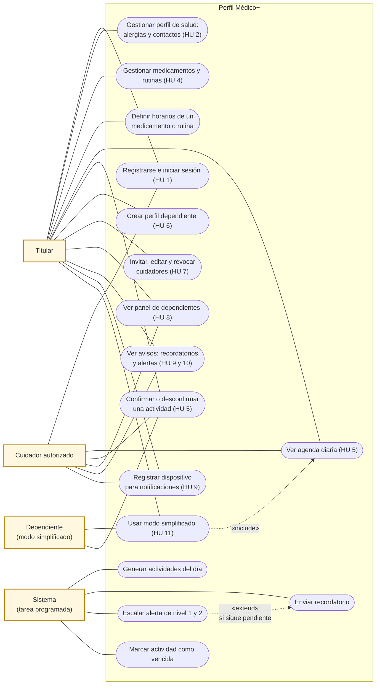
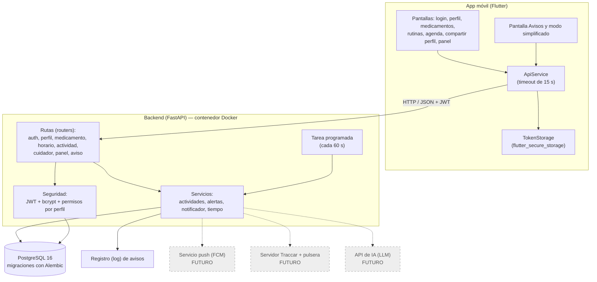
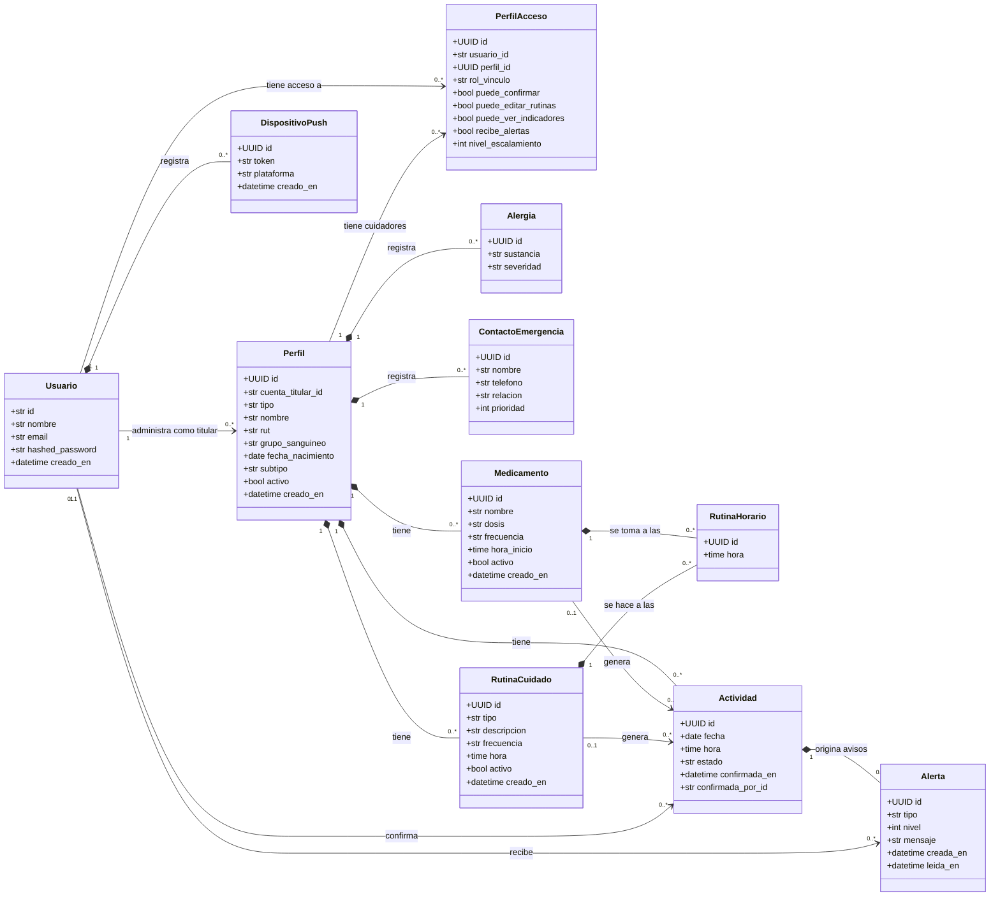
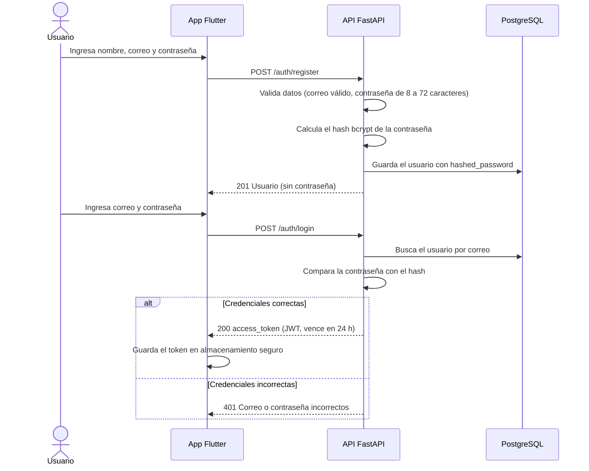
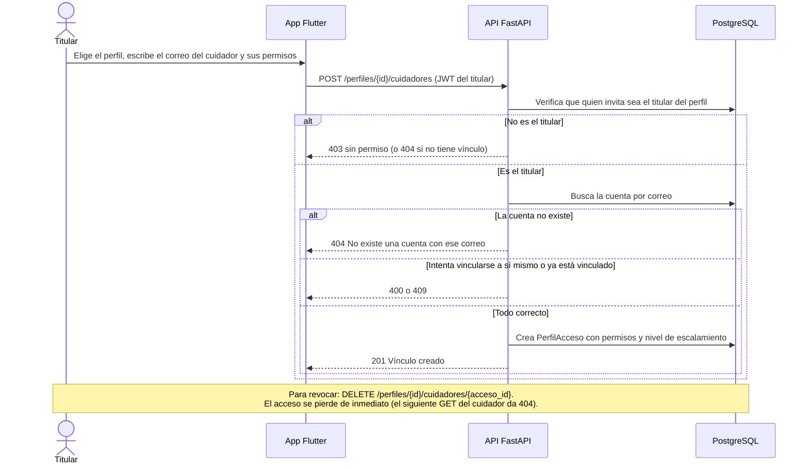
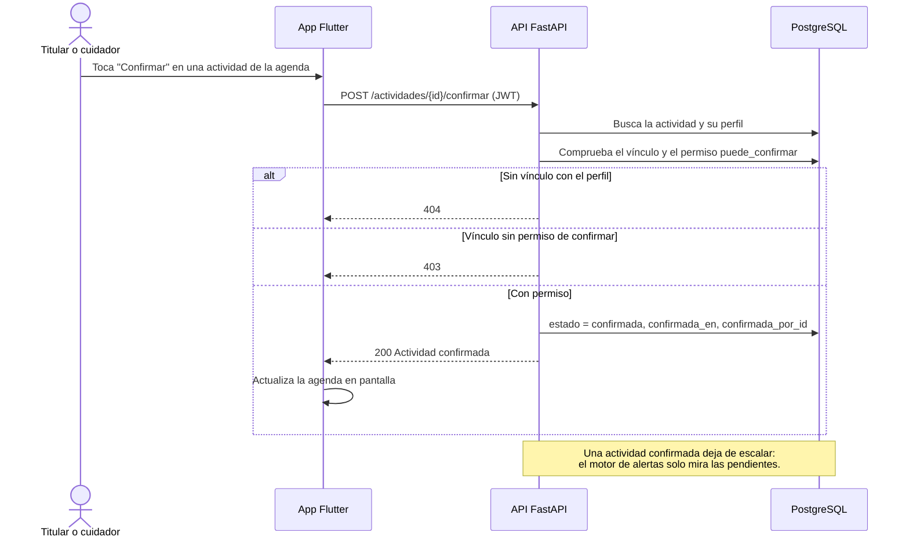
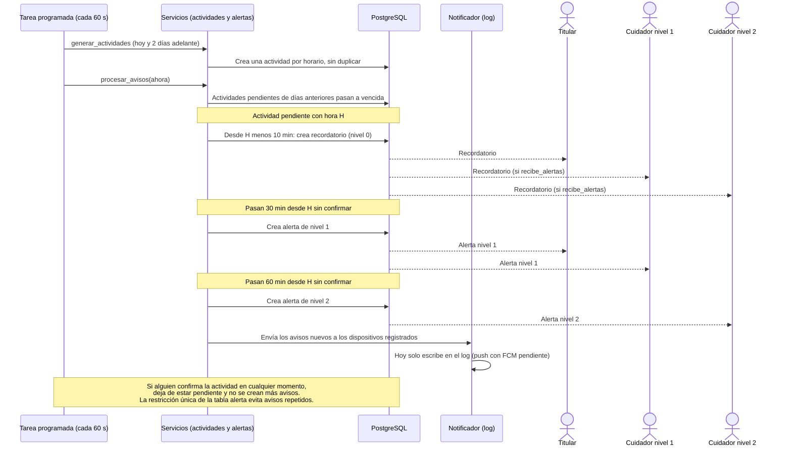
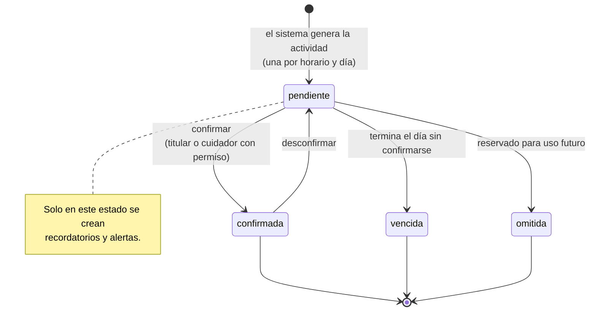

# Diagramas UML — Perfil Médico+

**Equipo 7 · Capstone_005D · Ingeniería Informática, Sede Plaza Oeste**
**Estado del sistema documentado:** Sprints 1 a 4 (backend FastAPI + PostgreSQL y app Flutter), al 5 de noviembre de 2026.

Los diagramas están escritos en [Mermaid](https://mermaid.js.org/), así que GitHub los dibuja directamente al abrir este archivo. Se hicieron a partir del código real del repositorio (rutas, modelos y servicios del backend), no de una idea general del sistema. Lo que todavía no está construido (pulsera, módulo de IA, push real con FCM) aparece marcado como **futuro**.

## Contenido

1. [Diagrama de casos de uso](#1-diagrama-de-casos-de-uso)
2. [Diagrama de componentes (arquitectura)](#2-diagrama-de-componentes-arquitectura)
3. [Diagrama de clases del dominio](#3-diagrama-de-clases-del-dominio)
4. [Diagramas de secuencia](#4-diagramas-de-secuencia)
   - 4.1 Registro e inicio de sesión
   - 4.2 Invitar a un cuidador (HU 7)
   - 4.3 Confirmar una actividad (HU 5)
   - 4.4 Recordatorios y alertas escalonadas (HU 9 y 10)
5. [Diagrama de estados de una actividad](#5-diagrama-de-estados-de-una-actividad)

---

## 1. Diagrama de casos de uso

Muestra quién usa el sistema y qué puede hacer. El **Sistema** es un actor porque la tarea programada del backend actúa sola, sin que nadie la active (corre cada 60 segundos).

**Notas**
- El cuidador solo puede hacer lo que el titular le permita en cada perfil (`puede_confirmar`, `puede_editar_rutinas`, `puede_ver_indicadores`, `recibe_alertas`). Una persona sin vínculo recibe error 404 y no ve nada.
- El dependiente confirma sus actividades desde la cuenta del titular, en modo simplificado, sin poder editar ni borrar datos.
- **Futuro (Sprints 5 y 6):** indicadores de salud e historial de cumplimiento (HU 12 y 13), botón de asistencia y módulo de IA (HU 14 y 15), pulsera con Traccar y Health Connect (HU 17 a 19), registro manual de glucosa (HU 20), recordatorios extendidos (HU 21) y farmacias cercanas con IA (HU 22).

---

## 2. Diagrama de componentes (arquitectura)

Muestra las piezas que se construyeron y cómo se comunican. Las líneas punteadas son partes planificadas que aún no existen.

**Notas**
- Hoy los avisos se guardan en la base de datos, se muestran en la pantalla Avisos y se escriben en el log (`NOTIFICADOR=log`). El push real al celular queda pendiente de elegir el proveedor.
- Docker Compose levanta la API y PostgreSQL con un solo comando; al arrancar aplica las migraciones y activa la tarea programada.

---

## 3. Diagrama de clases del dominio

Representa las tablas del modelo de datos como clases, con sus relaciones y multiplicidades. Es el mismo modelo que el diagrama ER de `Base de datos/Diagramas`, visto en notación UML.

**Reglas que la base de datos hace cumplir** (no solo el código):
- Una `Actividad` apunta a un medicamento **o** a una rutina, nunca a ambos ni a ninguno (restricción `ck_actividad_un_solo_origen`). Lo mismo vale para `RutinaHorario`.
- `estado` solo admite `pendiente`, `confirmada`, `vencida` u `omitida`.
- Una cuenta no puede tener dos perfiles `titular` (índice único).
- Una `Alerta` no se repite para la misma actividad, usuario, tipo y nivel, de modo que la tarea programada puede correr cada minuto sin duplicar avisos.
- Al borrar un perfil, medicamento, rutina o usuario, sus datos dependientes se borran en cascada.

---

## 4. Diagramas de secuencia

### 4.1 Registro e inicio de sesión

### 4.2 Invitar a un cuidador (HU 7)

### 4.3 Confirmar una actividad (HU 5)

### 4.4 Recordatorios y alertas escalonadas (HU 9 y 10)

Los plazos son los valores por defecto (`RECORDATORIO_MINUTOS_ANTES=10`, `ALERTA_PLAZO_1_MINUTOS=30`, `ALERTA_PLAZO_2_MINUTOS=60`) y se pueden cambiar con variables de entorno.

---

## 5. Diagrama de estados de una actividad

---

## Trazabilidad con el código

| Diagrama | Fuente en el repositorio |
|---|---|
| Casos de uso | Product Backlog (HU 1 a 22) y rutas en `backend/app/api/routes/` |
| Componentes | `backend/app/main.py`, `backend/docker-compose.yml`, `app_movil/lib/services/` |
| Clases | `backend/app/models/` y `Base de datos/modelo_datos.md` |
| Secuencia 4.1 | `routes/auth.py`, `core/security.py` |
| Secuencia 4.2 | `routes/cuidador.py` |
| Secuencia 4.3 | `routes/actividad.py` |
| Secuencia 4.4 | `services/actividades.py`, `services/alertas.py`, `services/notificador.py` |
| Estados | `models/actividad.py` y `services/alertas.py` |
